# YETI · 家

<p align="center">
  
</p>

<p align="center">
  <b>一座活着的像素小镇门户。</b><br>
  窗外下什么雨，镇里就下什么雨；今天是什么节气，树就是什么颜色。<br>
  童话外壳下面，是一台真实家庭服务器的控制台。
</p>

<p align="center">
  
  
  
  
</p>

---

## 这是什么

一个跑在自己家里的门户站：家人各自有首页，服务有统一入口，服务器有实时状态。

它和常见导航页的差别在于，这里的时间是真的。登录页和首页横幅共用同一套时令系统——**节气决定树的颜色和飘落物，昼夜决定光影与灯火，实况天气决定雨、雪、雾、雷**。所有画面都在浏览器里用 Canvas 画出来，服务端不为它多跑一个进程。

> 下面所有截图都来自仓库自带的演示站（`demo/`），人物、服务名和监控数字都是编的。

## 2026-10 更新

- 更新横幅小镇、场景内宠物工具条和动物图库。
- 天气支持同源快照优先、上游请求兜底；博客增加访问统计展示。
- 同步最近的布局修正，删除前端不再使用的旧逻辑。
- 正式登录服务移除默认口令，缺少账号或强签名密钥时拒绝启动。
- 新增隐私扫描与发布检查；私人运维记录、测试素材和生产配置不随仓库发布。

演示中的服务、统计和日志均为虚构数据。完整的私有服务器调度后端与第三方作品不包含在此仓库。详见 [更新说明](CHANGELOG.md)、[安全说明](SECURITY.md)。

## 一年被切成十二段

不是四张季节皮肤，是一张十二行的数据表：**初春 → 仲春 → 暮春 → 初夏 → 盛夏 → 晚夏 → 初秋 → 深秋 → 暮秋 → 初冬 → 隆冬 → 冬末**。每段各自定义植被色板、落叶／花瓣／萤火的粒子密度，以及一句给这个时节的说明。

打开登录页右下角的「四季图鉴」可以任意预览任意一段。

| | | | |
|---|---|---|---|
|  | 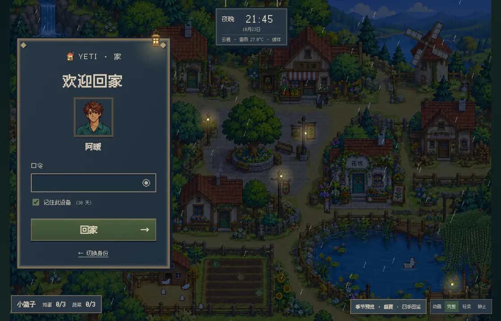 | 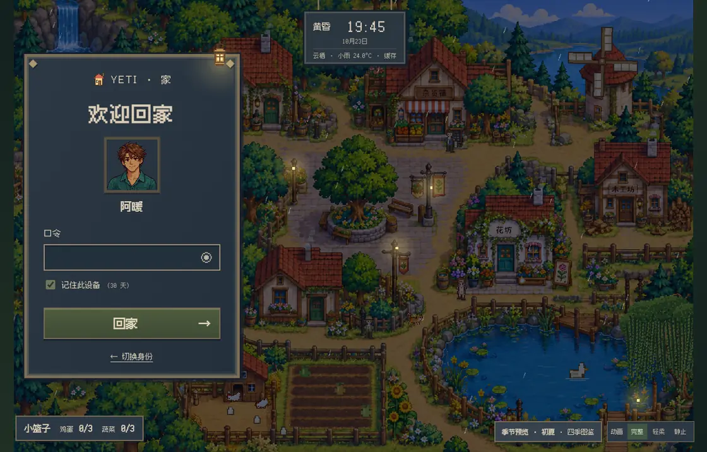 | 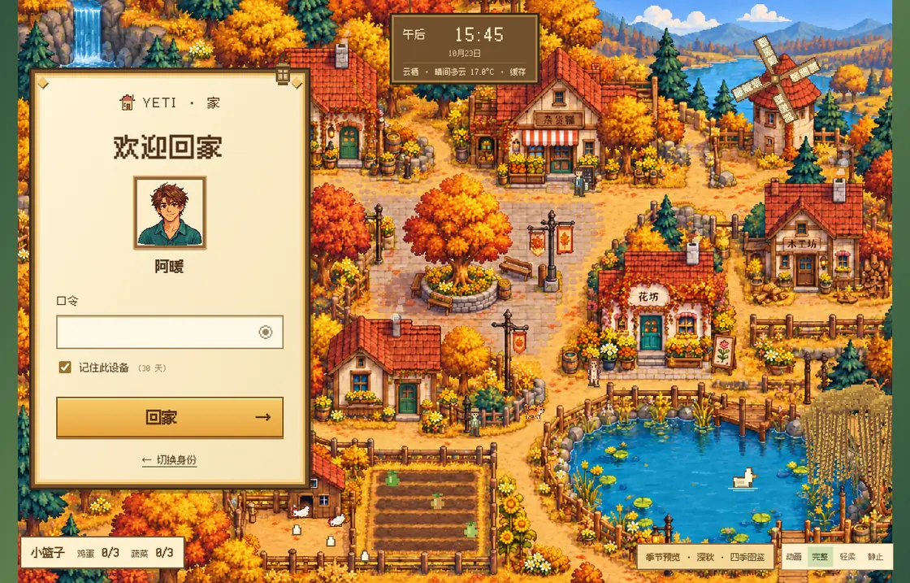 |
| 仲春 · 晴 · 午后 | 盛夏 · 雷雨 · 夜 | 初夏 · 小雨 · 黄昏 | 深秋 · 晴 · 午后 |
| 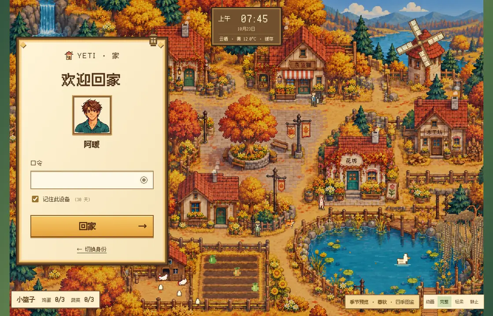 | 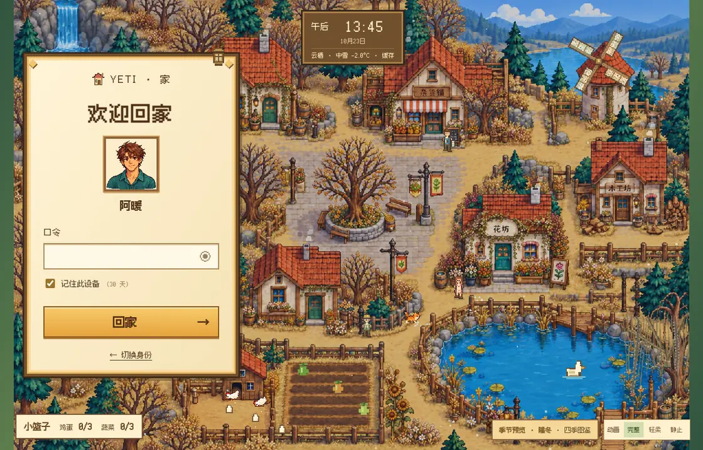 | 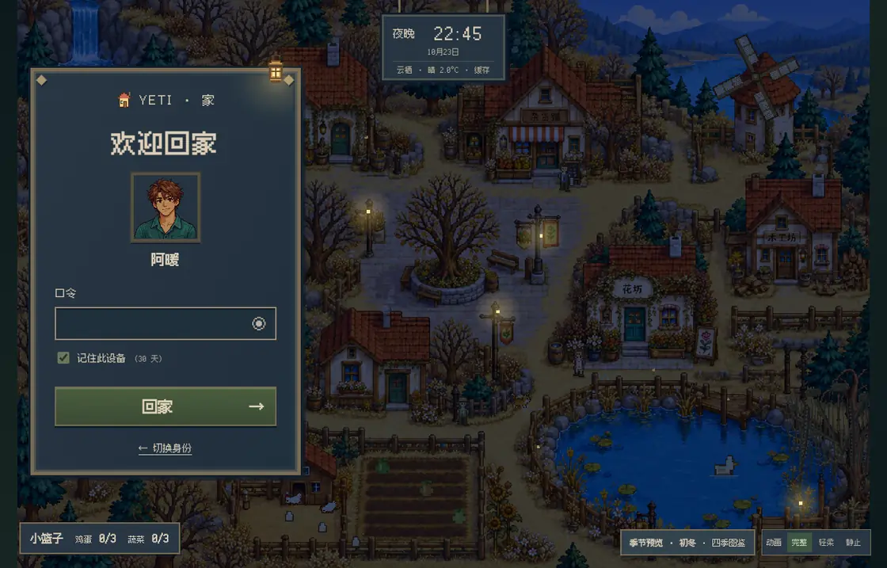 | 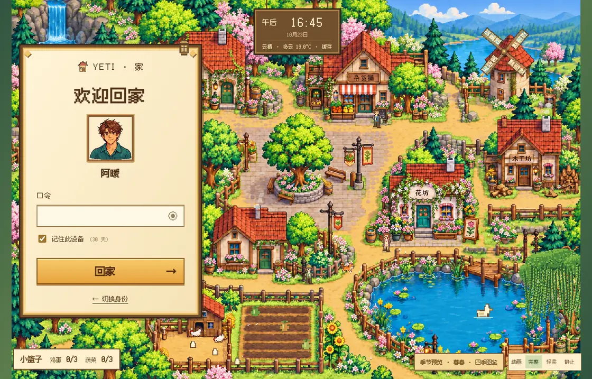 |
| 暮秋 · 雾 · 清晨 | 隆冬 · 中雪 · 午后 | 初冬 · 晴 · 深夜 | 暮春 · 多云 · 大风 |

八张气候图来自首次发布的演示站，由 `site/static/town-environment-v9.js` 控制季节和光照。新的首页横幅与动物图库截图见下方。

**昼夜**按你所在城市的真实日出日落插值换光，分清晨／上午／午后／黄昏／夜晚五段，黄昏有晚霞层，入夜路灯和窗户一盏盏亮起来。

**天气**优先读取同源快照，失败时回退到 [Open-Meteo](https://open-meteo.com/) 实况：晴、云、雾、雨、雪、雷雨六种天象直接画进画面，雨夜萤火会熄灭，风大了风车转得更快。取不到天气就安静地降级成无天气模式，页面不会白屏。

## 镇上住着人，也养着猫

<p align="center">
  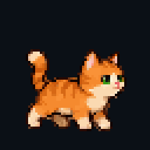
  
</p>

杂货铺前站着**报童**，点开就是当天的新闻（抓中新网的滚动新闻 RSS，抓不到就聊点小镇日常）；**花店姑娘**和**菜园爷爷**沿着各自的路线散步，都能搭话。鸡舍能捡蛋，田里能收菜，收获装进你的小篮子。

首页横幅里的猫和狗是活的精灵：点哪里就走向哪里，「叫小狗」「喂小猫」一键召唤，喂满四口才算喂饱。独立[动物图库](site/yeti/cats/index.html)提供分类、动作预览与素材下载。

上面两只猫的动画不是录屏，是从仓库自己的精灵图集 `site/static/pixel/cat-v3/atlas.png` 里抽帧出来的。

## 童话外壳里面

<p align="center">
  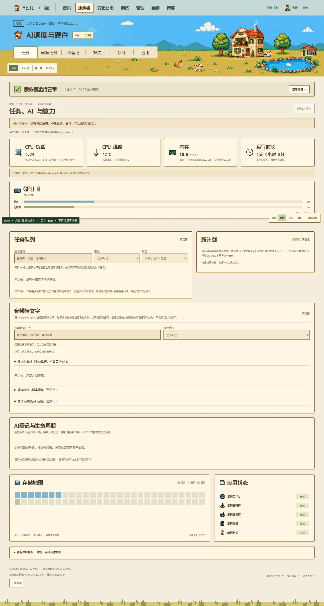
  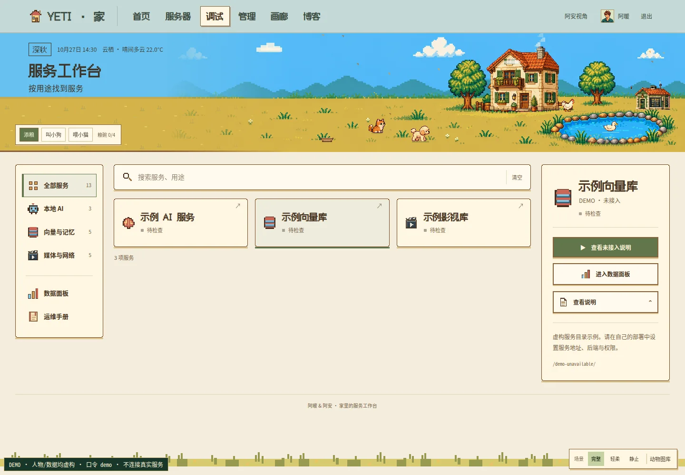
</p>
<p align="center">
  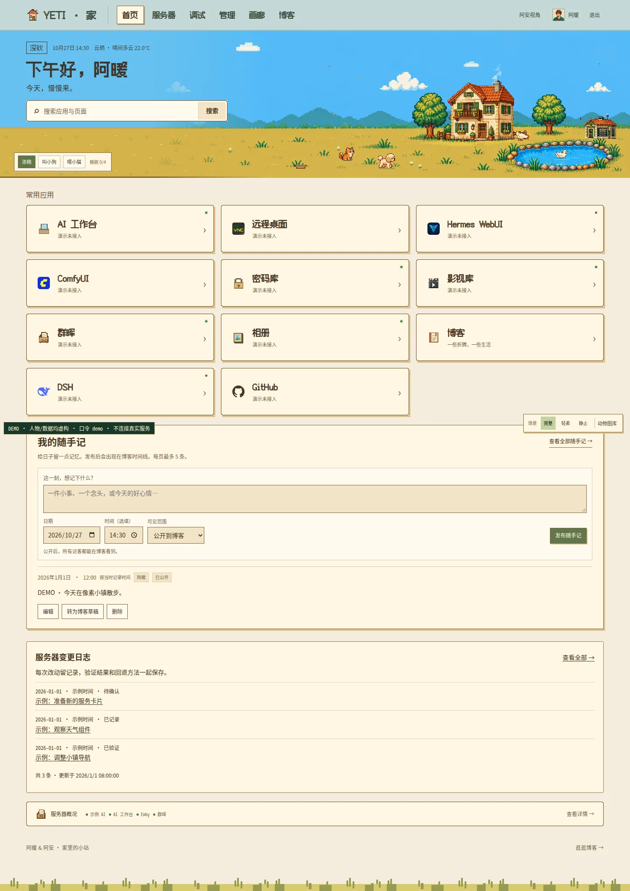
  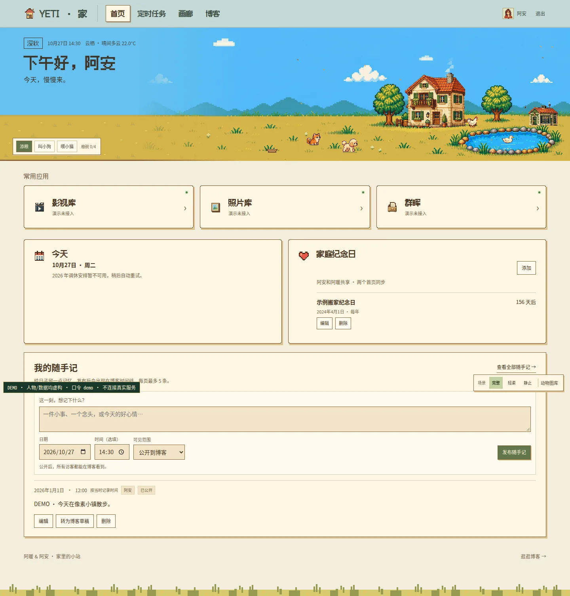
</p>

- **服务器状态**里的数字是真的：CPU 与 GPU 的显存／温度／功耗、存储温度色块与服务健康探测。两条采集管线分别提供全量与高频 JSON 快照；需要自己配置采集与计划任务，演示站不读取机器状态。
- **两位家人各有首页**，权限分 admin / user 两级，路径前缀就是门禁。
- **生活数据**（随手记、纪念日）走 Python 标准库 API：写文件前 mkstemp + fsync + rename，改记录带 revision 号，两个人同时编辑不会互相覆盖。
- **定时任务界面**保留，正式使用需要另接自己的任务后端；演示不执行任何系统任务。

<p align="center">
  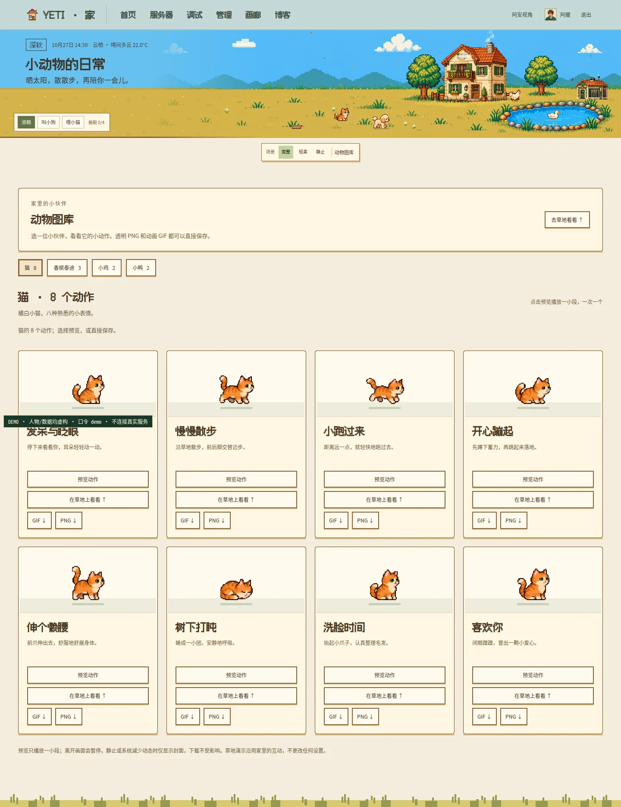
  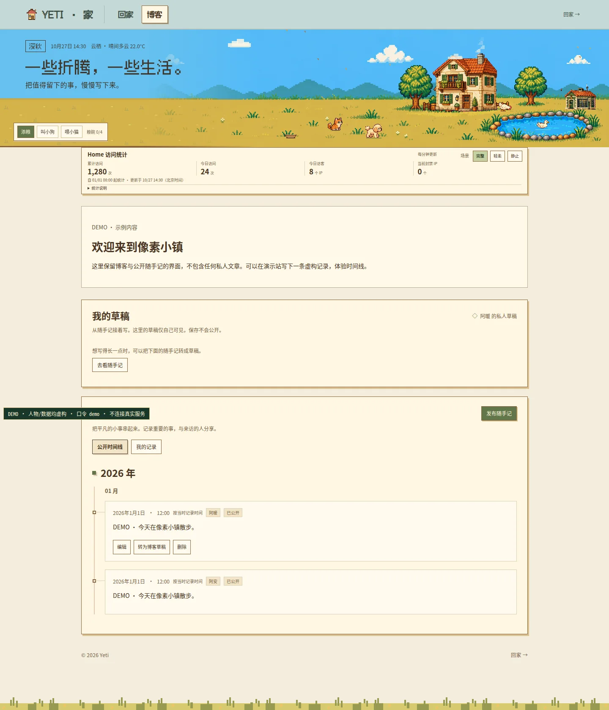
</p>

## 跑起来看看

需要 Python 3.10+，没有其他依赖。

```bash
git clone https://github.com/matingod/yeti-home.git && cd yeti-home
python3 demo/demo-server.py          # 打开 http://127.0.0.1:8990
```

演示站用的是**仓库内的 gatekeeper 登录与签名代码**，喂给它的却是**内存里的虚构数据**——所以不需要数据库、不需要采集脚本，克隆下来就能看到小镇、双首页、监控页和服务工作台。登录口令是 `demo`。

## 目录

```
yeti-home/
├── site/                  # 静态站：双人格页面 + 世界引擎 + 自绘像素资产
├── gatekeeper/            # 登录鉴权与生活 API，Python 标准库
├── collector/             # 60s / 10s 双采集管线（shell 采集 + node 组装，无常驻进程）
├── caddy/Caddyfile.example # 最小路由与门禁模板，按部署环境配置
├── config/                # 用户、纪念日、服务清单的示例配置
├── demo/                  # 仅回环监听的虚构演示服务器
├── ops/                   # 可选的天气、统计与日志生成器
├── tools/                 # 发布隐私扫描
├── tests/                 # 登录安全默认值与扫描器测试
└── docs/                  # 部署笔记 + 截图素材
```

## 部署到自己的服务器

三条路，按需要挑一条：

1. **只要静态站**：把 `site/` 丢进任意 nginx，照着 `config/*.example.json` 填自己的服务清单。
2. **要登录和记事**：先初始化账号和随机签名密钥，再启动 `gatekeeper/`，使用 `caddy/Caddyfile.example` 配置门禁。不要直接发布运行时数据目录。
3. **要硬件监控**：按自己的平台调整 `collector/`，测试采集后再配置计划任务。可选运维工具见 [后端说明](docs/backend-update.md)。

细节写在 [docs/deploy-notes.md](docs/deploy-notes.md)。

## 几个刻意的决定

- **原生前端**：小镇和门户使用原生 DOM 与 Canvas，不要求前端构建工具。
- **文件存储**：状态快照可以重采；账号、纪念日和随手记是持久数据，应单独备份，不能随意删除。
- **后端规模小**：Caddy 托管静态文件并转发门禁；Python 服务负责登录与生活 API，采集器按计划写入快照。
- **动效可以关**：右下角能在「完整 / 轻柔 / 静止」之间切换，也尊重系统的 `prefers-reduced-motion`；页面切到后台就停帧。

## 改之前要知道的两件事

1. **城市与坐标**：`site/static/town-weather-v9.js` 顶部的 `LOCATION`、`LAT`、`LON` 是示例值，换成你所在城市即可。
2. **账号标识**：默认账号是 `yeti` 与 `yuki`（对应 `/yeti/`、`/yuki/` 两个目录）。想换成自己的，改 `config/*.example.json` 的键名、目录名，以及 `site/static/home-journal-v14.js` 里的 `PEOPLE` 映射。

## 许可与来源

| 对象 | 许可 |
|---|---|
| 全部代码（HTML / CSS / JS / Python / Shell / Caddyfile） | [MIT](LICENSE) |
| 自绘像素美术（小镇场景、猫狗精灵、居民、图标） | [CC BY-NC 4.0](LICENSE-assets.md) —— 个人使用随意，商用请先联系 |
| 像素字体（Fusion Pixel / Ark Pixel / Cubic 11 / Galmuri） | 各自原厂 OFL 许可，字体目录内附原文 |
| 内嵌历法库 [lunar-javascript](https://github.com/6tail/lunar-javascript)（`town-dialogue-v1.js`） | MIT；保留上游 6tail 署名与许可全文 |
| 天气数据 [Open-Meteo](https://open-meteo.com/) · 新闻 [中新网](https://www.chinanews.com.cn/) RSS · 节假日数据 [holiday-cn](https://github.com/NateScarlet/holiday-cn) | 运行时依赖，不随仓库分发 |

## 最后

这座小镇跑在我家的服务器上，2026 年 10 月上线第一个版本，是我和 AI 助手一句一句写出来的——从精灵图的每一帧到 PBKDF2 的迭代次数。

开源它，是想看看「把家的样子写成代码」这件事还能被改成什么样。遇到 bug 开个 issue，都会回。